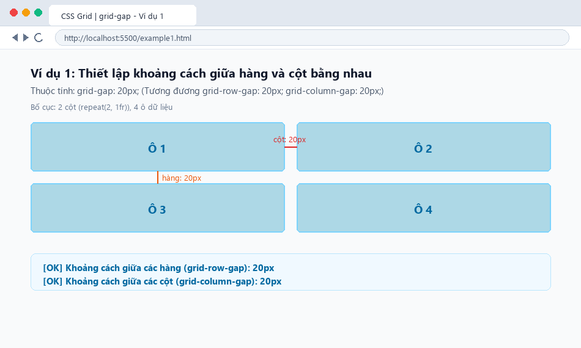
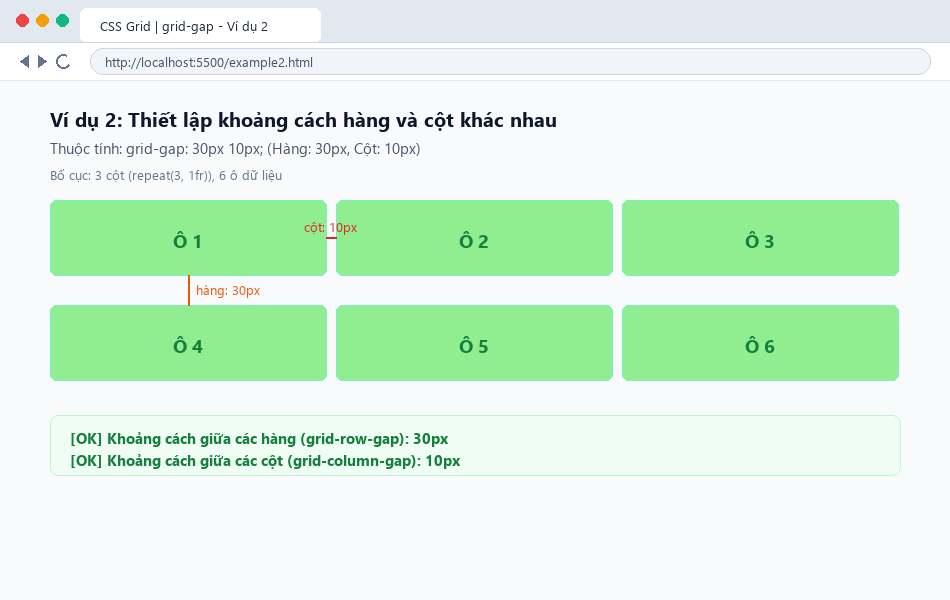
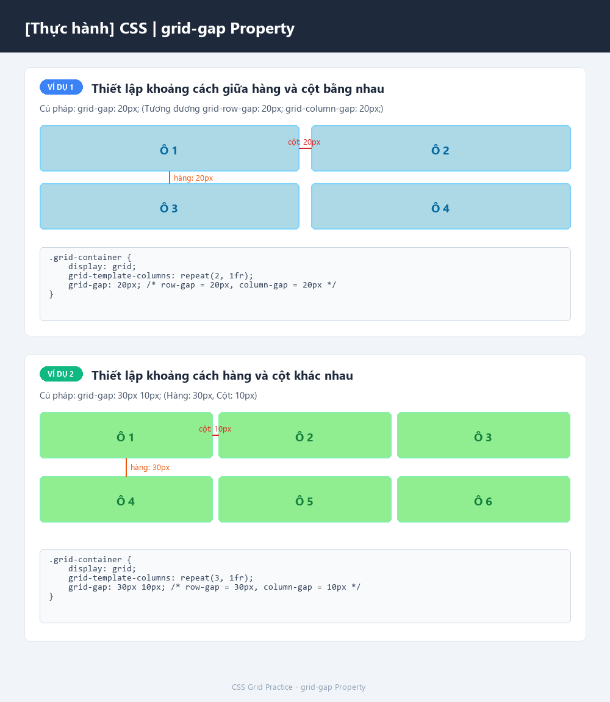

# [Thực hành] CSS | grid-gap Property

Bài thực hành tìm hiểu và áp dụng thuộc tính `grid-gap` (khoảng cách giữa các hàng và cột) trong bố cục lưới CSS Grid.

---

## 📖 1. Lý thuyết & Cú pháp

Thuộc tính `grid-gap` đặt kích thước của khoảng cách giữa các hàng và các cột trong bố cục lưới CSS Grid.

Nó là thuộc tính viết tắt (shorthand) cho 2 thuộc tính:
- `grid-row-gap`: Đặt kích thước khoảng cách giữa các hàng (mặc định: `0`).
- `grid-column-gap`: Đặt kích thước khoảng cách giữa các cột (mặc định: `0`).

### Cú pháp:
```css
/* Cú pháp tổng quát: hàng cột */
grid-gap: <grid-row-gap> <grid-column-gap>;

/* Hoặc viết 1 giá trị chung cho cả hàng và cột */
grid-gap: <gap-chung>;
```

### 💡 Lưu ý quan trọng trong CSS hiện đại:
Trong CSS hiện đại, thuộc tính `gap` được chuẩn hóa và khuyến khích sử dụng thay cho `grid-gap`:
```css
gap: 30px 10px;
```
Thuộc tính `gap` hoạt động tốt trên cả **CSS Grid** lẫn **CSS Flexbox**.

---

## 🛠️ 2. Các ví dụ thực hành

### Ví dụ 1: Thiết lập khoảng cách giữa hàng và cột bằng nhau
- **Mã nguồn:** [`example1.html`](example1.html) & [`style1.css`](style1.css)
- **Ý tưởng:** Bố cục lưới 2 cột (`repeat(2, 1fr)`), 4 phần tử `div`.
- **CSS áp dụng:**
  ```css
  .grid-container {
      display: grid;
      grid-template-columns: repeat(2, 1fr);
      grid-gap: 20px;
  }
  .grid-container div {
      background-color: lightblue;
      padding: 20px;
      text-align: center;
  }
  ```
- **Giải thích:** `grid-gap: 20px;` thiết lập khoảng cách đều nhau 20px cho cả hàng và cột (tương đương `grid-row-gap: 20px; grid-column-gap: 20px;`).

### Ví dụ 2: Thiết lập khoảng cách hàng và cột khác nhau
- **Mã nguồn:** [`example2.html`](example2.html) & [`style2.css`](style2.css)
- **Ý tưởng:** Bố cục lưới 3 cột (`repeat(3, 1fr)`), 6 phần tử `div`.
- **CSS áp dụng:**
  ```css
  .grid-container {
      display: grid;
      grid-template-columns: repeat(3, 1fr);
      grid-gap: 30px 10px;
  }
  .grid-container div {
      background-color: lightgreen;
      padding: 20px;
      text-align: center;
  }
  ```
- **Giải thích:** `grid-gap: 30px 10px;` thiết lập:
  - `30px`: Khoảng cách giữa các hàng (`grid-row-gap`).
  - `10px`: Khoảng cách giữa các cột (`grid-column-gap`).

---

## 📸 3. Ảnh chụp kết quả trên trình duyệt

### Kết quả Ví dụ 1 (`grid-gap: 20px;`):


### Kết quả Ví dụ 2 (`grid-gap: 30px 10px;`):


### Tổng hợp cả 2 ví dụ:


---

## 📁 4. Cấu trúc thư mục

```text
grid-gap-practice/
├── index.html              # Trang tổng hợp lý thuyết, 2 ví dụ và bảng so sánh
├── style.css               # Định dạng giao diện trang tổng hợp
├── example1.html           # File độc lập Ví dụ 1 (grid-gap: 20px)
├── style1.css              # CSS Ví dụ 1
├── example2.html           # File độc lập Ví dụ 2 (grid-gap: 30px 10px)
├── style2.css              # CSS Ví dụ 2
├── screenshot_vidu1.png    # Ảnh chụp kết quả Ví dụ 1
├── screenshot_vidu2.png    # Ảnh chụp kết quả Ví dụ 2
├── tat_ca_vi_du.png        # Ảnh chụp kết quả tổng hợp 2 ví dụ
└── README.md               # Tài liệu thuyết minh bài tập
```

---

## 🚀 5. Hướng dẫn mở và kiểm tra trên trình duyệt
1. Mở trực tiếp file `index.html`, `example1.html` hoặc `example2.html` bằng bất kỳ trình duyệt nào (Chrome, Edge, Firefox).
2. Nhấn phím `F12` (Inspect Element), chọn tab **Elements** và rê chuột vào thẻ `.grid-container` để quan sát đường viền kẻ lưới (Grid Inspector) và các khoảng cách hàng/cột (`gap`) hiển thị trực quan.
